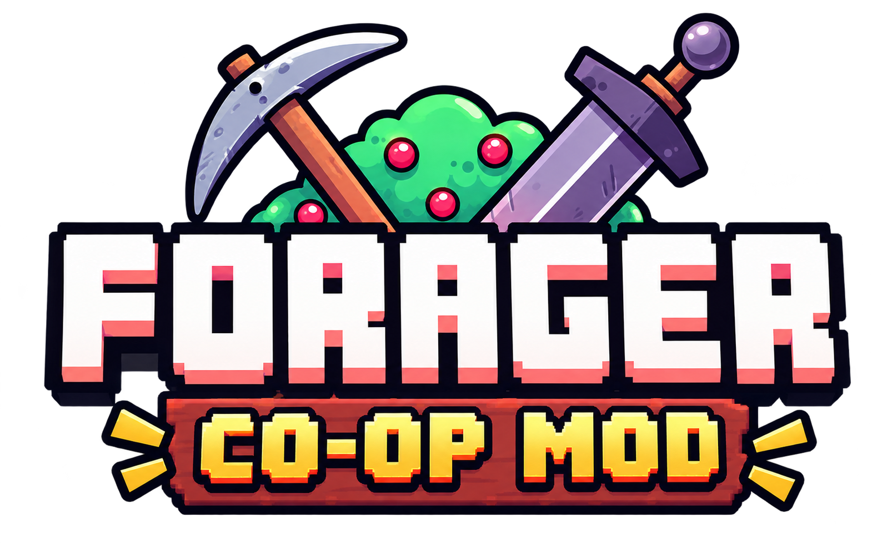
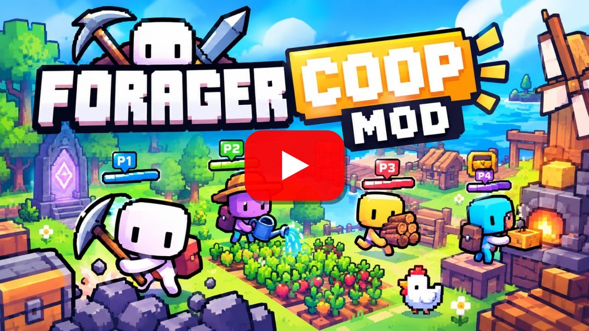

<p align="center">
  
</p>

<p align="center">
  <b>Online co-op for <a href="https://store.steampowered.com/app/751780/Forager/">Forager</a> — up to 4 players, one DLL, no game files changed.</b>
</p>

<p align="center">
  <a href="https://github.com/melogo5/forager-coop/releases/latest"></a>
  <a href="https://discord.gg/BjsubWefm4"></a>
  <a href="LICENSE"></a>
</p>

<p align="center">
  English · <a href="README.ru.md">Русский</a>
</p>

## Showcase

<p align="center">
  <a href="https://www.youtube.com/watch?v=apy2HmzMUoY"></a>
  <br>
  <a href="https://www.youtube.com/watch?v=apy2HmzMUoY"><b>▶ Watch the showcase on YouTube</b></a>
</p>

## Features

- **Up to 4 players** in one world: a host and up to three guests.
- **Steam invites** — the host presses **F2** in the world and invites friends; no IP addresses or VPN needed.
  LAN, Hamachi and Radmin work too.
- **A COOP button in the main menu** — create a world or join one from a list of servers on your network.
- **Shared world:** resources, mobs, buildings, chests, storage, bridges, islands bought by the host, time of day
  and weather.
- **Shared progress:** one level and XP bar, shared coins, one skill tree (a skill learned by anyone is learned for
  everyone, skill points are personal), shared museum and NPC quests.
- **Your own character:** each guest keeps their inventory, gear, familiars and costume — the host stores them by
  the guest's name, so you come back as yourself.
- **Dungeons together:** everyone goes in and out together; puzzles, lanterns, keys and chests are synced.
- **No game over:** a dead player gets back up on the starting island (or at the dungeon entrance).

> **Status: beta.** Most of the game plays fine together, but some things can still go out of sync.
> Please report bugs on [Discord](https://discord.gg/BjsubWefm4) or in [Issues](https://github.com/melogo5/forager-coop/issues).

## Requirements

- Every player needs their own copy of **Forager on Steam, version 4.1.9** (the current Steam build, 2021-01-29).
  On any other build the DLL does nothing.
- Windows.
- Only **Classic** worlds can be played in co-op.
- Forager's own Mod API mods are not supported.

## Installation

1. Download `version.dll` from the [latest release](https://github.com/melogo5/forager-coop/releases/latest).
2. Put it in the game folder, next to `Forager.exe`
   (Steam → Forager → Manage → Browse local files).
3. Every player has to do this.

A **COOP** button appears in the main menu. To uninstall, delete `version.dll` from the game folder.

## How to play

**Host**

1. Main menu → **COOP** → **CREATE** → choose a save or **+** for a new Classic world.
2. In the world press **F2** to invite friends through Steam.

**Guest**

- **Through Steam:** accept the host's invite in Steam — the game connects by itself (if Forager isn't running,
  Steam starts it).
- **On the same network (LAN, Hamachi, Radmin):** main menu → **COOP** → type your name in **NAME** → pick the
  host's server → **JOIN**. If the server isn't listed, type the host's IP in **IP** → **CONNECT**.

The host's world loads on the guest's side automatically; the guest's own saves are not touched.

**Good to know**

- Allow Forager through the Windows Firewall when asked. For LAN/VPN play the ports are TCP 7790 and UDP 7791.
- Only the host buys islands (the BUY LAND tab), and only the host gets Steam achievements.
- To leave, use **Save and exit to menu**. When the host leaves, the guests go back to the main menu.
  A guest can rejoin without restarting the game.
- Put an empty `coop_skip_intro.txt` next to `Forager.exe` to skip the publisher logos at startup.

## Known issues

- The **Void** trial isn't supported in co-op yet.
- Occasionally a guest loads a slightly different world (extra or missing trees); the mod corrects it within a few
  seconds.
- If something breaks, the log is in the game folder: `coop_native_<number>.log`. Attach it to your bug report.

## Building from source

You need Visual Studio Build Tools with C++ (x86 toolset).

```powershell
git clone --recursive https://github.com/melogo5/forager-coop.git
cd forager-coop
powershell -File native\build.ps1 -Install -GameDir "C:\Program Files (x86)\Steam\steamapps\common\Forager"
```

The DLL is built to `native\build\version.dll`; `-Install` also copies it to the game folder.
Pushing a `v*` tag builds the DLL on GitHub Actions and publishes a release (a tag with a `-`, like `v0.2.0-beta1`,
becomes a pre-release).

### How it works

Forager is built with GameMaker YYC (GML compiled to machine code), so there are no scripts to edit. Instead
`version.dll` proxies the Windows system library of the same name and hooks the game's functions with
[MinHook](https://github.com/TsudaKageyu/minhook). The host is authoritative: the world lives and is saved only on
the host; guests get a snapshot of it when they join and then a stream of changes. Each other player is a second
`objPlayer` with its own logic switched off (a "puppet"), and the host performs a guest's actions on their behalf.

The developer documentation is in Russian:

| Folder | Contents |
|---|---|
| [`native/`](native/) | source of `version.dll` |
| [`docs/coop/`](docs/coop/) | spec, architecture, status, playtest notes |
| [`tools/gametest/`](tools/gametest/) | test automation: two game windows, clicks, screenshots |
| [`mods/CoopTest/`](mods/CoopTest/) | the first prototype on the Mod API (frozen) |

## Legal

The code and notes in this repository are under the [MIT license](LICENSE). The repository contains no game code or
assets. You need a purchased copy of Forager to play.

Forager © HopFrog / Humble Games. This project is not affiliated with or endorsed by the game's authors.
MinHook is under BSD-2-Clause.
